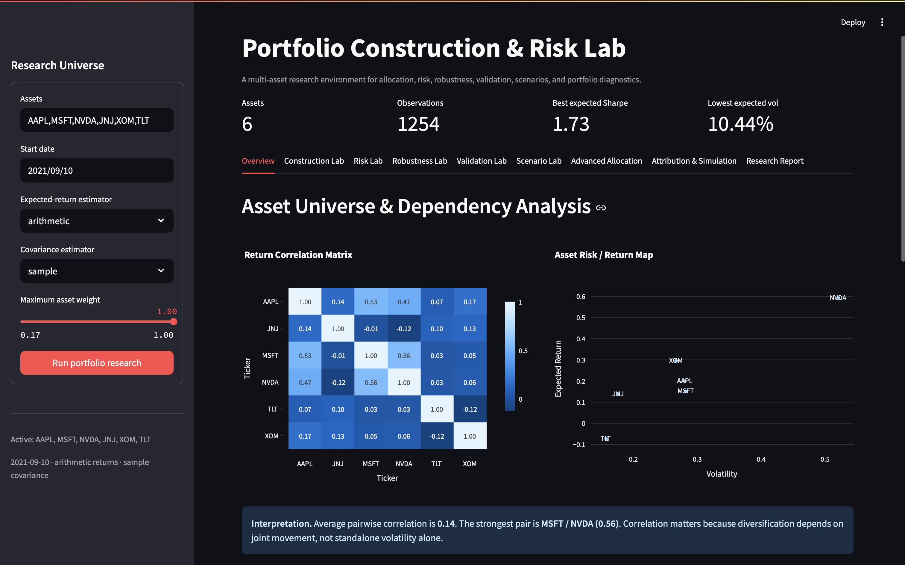
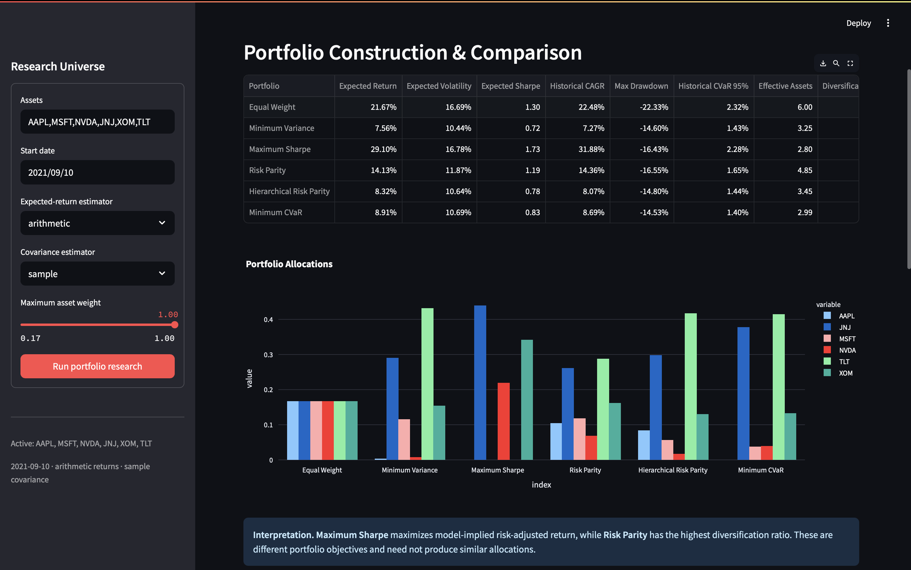
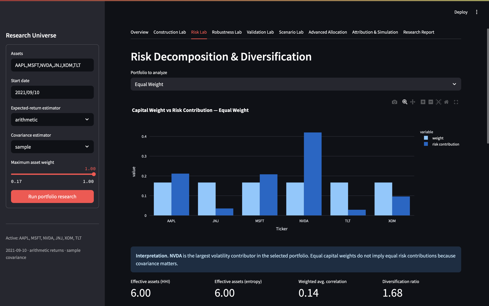
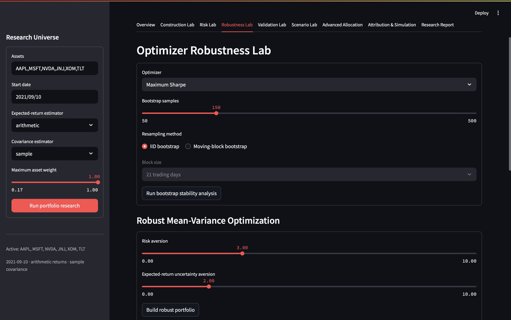
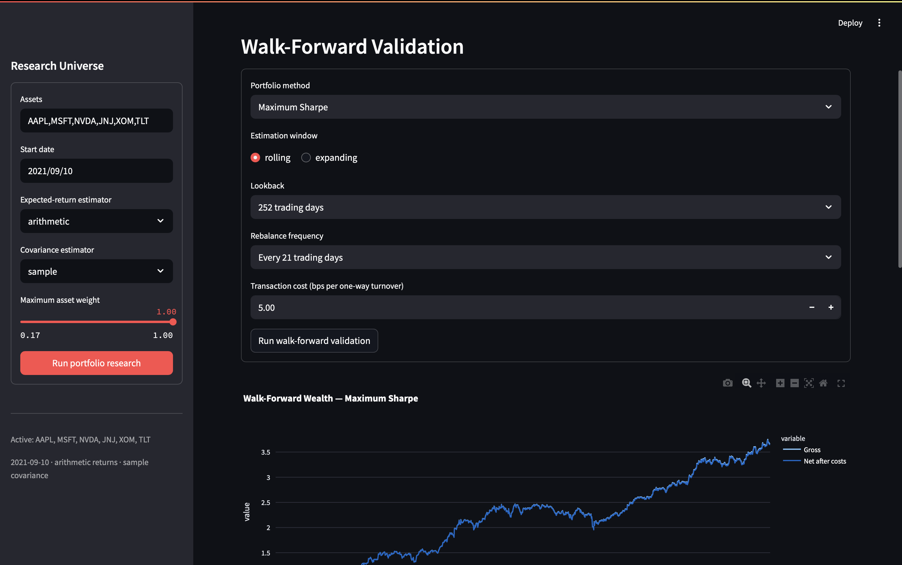
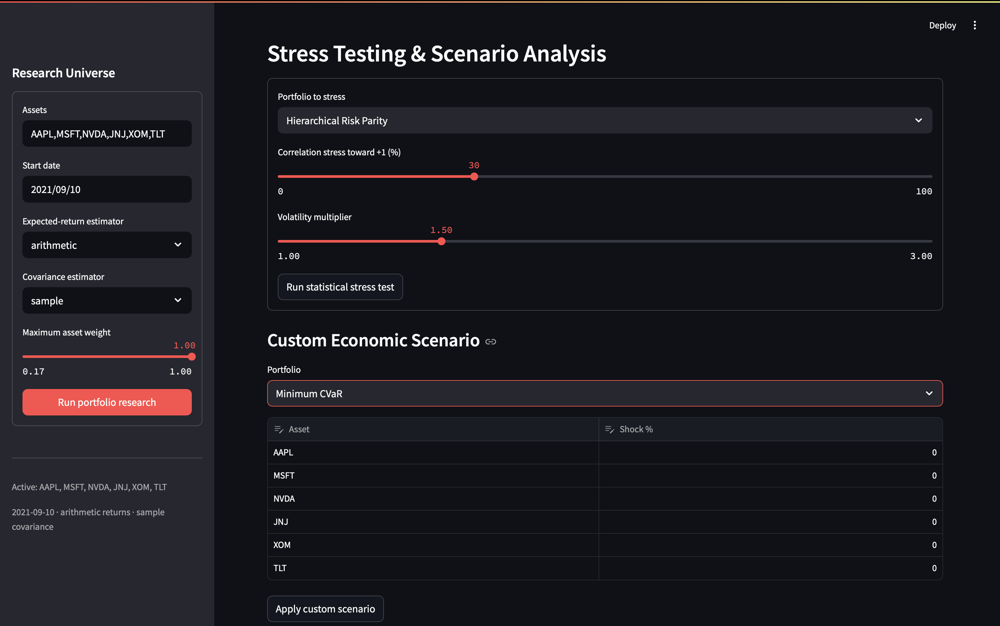
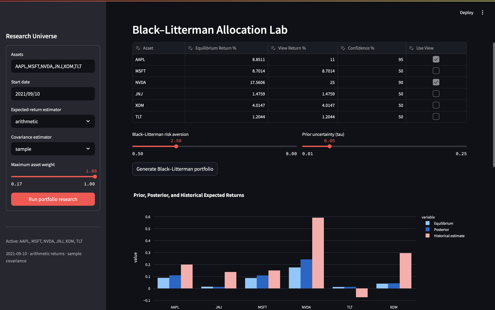
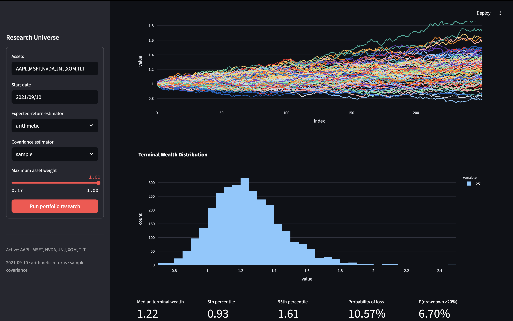
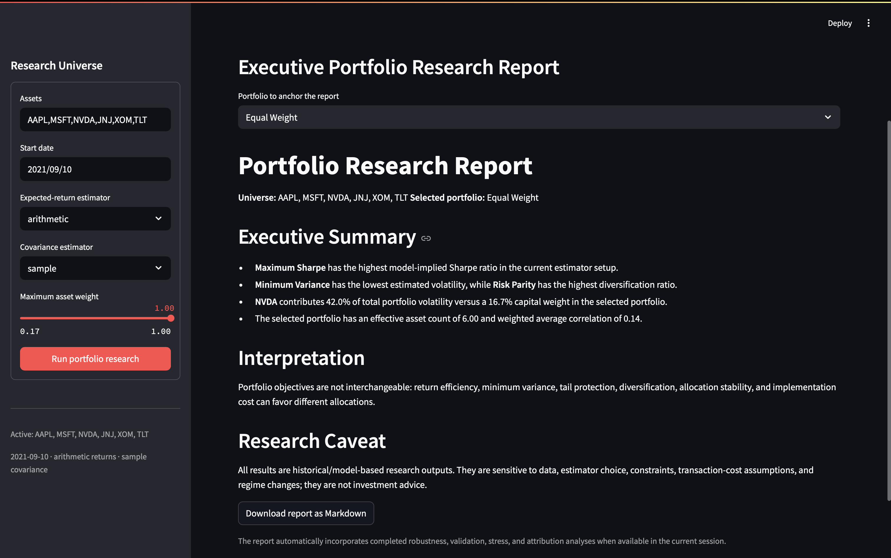

# Portfolio Construction & Risk Lab

A modular quantitative research platform for studying **multi-asset portfolio construction, diversification, risk allocation, estimation uncertainty, robustness, and out-of-sample behavior**.


[](LICENSE)

Rather than treating an optimizer's output as a definitive answer, the project asks a broader question:

> **How should capital be allocated across assets, where does the resulting risk come from, and how much confidence should we place in an allocation built from uncertain historical estimates?**

The application therefore combines classical and modern allocation methods with risk decomposition, resampling, stress testing, implementation constraints, walk-forward validation, attribution, and probabilistic simulation.

> **Research scope:** this project is intended for quantitative research and education. It does not provide investment recommendations. All results depend on historical data, model assumptions, estimator choices, constraints, and user-specified inputs.

---

## Application Overview

<p align="center">
  
</p>

The interface is separated into dedicated research labs so that portfolio construction, risk, robustness, validation, scenarios, and advanced allocation can be investigated independently while sharing the same asset universe and estimation assumptions.

| Lab | Research question |
|---|---|
| **Overview** | What does the selected asset universe look like statistically? |
| **Construction Lab** | How do different portfolio-construction objectives allocate capital? |
| **Risk Lab** | Where does portfolio risk come from, and how diversified is it? |
| **Robustness Lab** | How sensitive is the allocation to sampling error and implementation constraints? |
| **Validation Lab** | Does the allocation behave as expected out of sample and after trading costs? |
| **Scenario Lab** | How does the portfolio respond to stressed or historical crisis conditions? |
| **Advanced Allocation** | How do Black-Litterman views and tail-risk objectives alter the portfolio? |
| **Attribution & Simulation** | What drove performance, and what outcome distribution does the model imply? |
| **Research Report** | What are the main conclusions across the analysis? |

---

## Portfolio Construction

The platform compares several allocation philosophies rather than presenting a single portfolio as universally optimal:

- **Equal Weight** as a transparent baseline
- **Global Minimum Variance** for minimum model-implied volatility
- **Maximum Sharpe** for estimated excess return per unit of risk
- **Risk Parity / Equal Risk Contribution** for balanced risk allocation
- **Hierarchical Risk Parity (HRP)** for cluster-aware allocation
- **Minimum CVaR / Expected Shortfall** for downside-tail-risk minimization
- **Black-Litterman** for combining equilibrium-implied returns with confidence-weighted views
- **Robust mean-variance optimization** for reducing sensitivity to expected-return uncertainty
- **Custom risk budgeting** for user-defined risk-contribution targets

The Construction Lab also includes a constrained **efficient frontier**, estimator-combination comparison, and objective-based portfolio ranking.

<p align="center">
  
</p>

### Estimation choices

Portfolio optimization is only as reliable as its inputs. Expected returns can be estimated using **arithmetic mean, geometric mean, or EWMA**, while covariance can be estimated using **sample covariance, EWMA, or Ledoit-Wolf shrinkage**.

The Estimator Comparison Lab makes this uncertainty explicit by showing how reasonable changes in the return and covariance models can alter the resulting allocation.

---

## Risk Decomposition & Diversification

Portfolio weights alone do not describe portfolio risk. The Risk Lab decomposes total volatility into **marginal and component risk contributions**, making it possible to identify assets whose contribution to risk is disproportionate to their capital weight.

Additional diagnostics include:

- diversification ratio
- effective number of assets
- HHI and entropy concentration
- weighted average correlation
- marginal diversification contribution
- volatility-targeted risky exposure with explicit cash allocation
- custom risk-budget portfolios

<p align="center">
  
</p>

This distinction is central to the project: **equal capital allocation does not imply equal risk allocation**.

---

## Robustness Lab

An optimized portfolio is conditional on estimated expected returns and covariance. The Robustness Lab tests whether the apparent optimum remains credible when those estimates are perturbed.

### Bootstrap allocation stability

Two resampling approaches are supported:

- **IID bootstrap** resamples individual historical return observations.
- **Moving-block bootstrap** resamples consecutive return blocks to preserve short-run time-series dependence more effectively.

The portfolio is repeatedly re-estimated and re-optimized, producing distributions of asset weights rather than relying on a single point estimate.

### Constrained & turnover-aware optimization

The platform can balance theoretical optimality against implementation realism using:

- minimum and maximum position weights
- volatility ceilings
- maximum turnover constraints
- turnover penalties relative to a reference portfolio

This allows comparison between an unconstrained theoretical target and a portfolio that may be more practical to implement.

<p align="center">
  
</p>

---

## Walk-Forward Validation & Rebalancing

In-sample optimization alone does not establish that an allocation will behave similarly on unseen data. The Validation Lab repeatedly estimates a portfolio using historical information and evaluates the resulting weights over a subsequent out-of-sample holding period.

Both **rolling** and **expanding** estimation windows are supported, with analysis of:

- predicted versus realized volatility
- gross versus net-of-cost performance
- portfolio turnover
- transaction costs
- allocation changes through time

The Rebalancing Policy Lab additionally compares **calendar**, **single-asset drift threshold**, and **portfolio-distance threshold** rebalancing rules.

<p align="center">
  
</p>

---

## Stress Testing & Scenario Analysis

Diversification relationships are not constant, particularly during market stress. The Scenario Lab examines portfolio behavior when assumptions deteriorate through:

- correlation stress toward stronger common movement
- volatility shocks
- custom asset-level return scenarios
- historical crisis replay

<p align="center">
  
</p>

These tools complement historical backtests by asking how an allocation behaves when the covariance structure or asset returns move away from ordinary conditions.

---

## Advanced Allocation

### Black-Litterman

The Black-Litterman module begins with equilibrium-implied expected returns and combines them with optional **investor views and confidence levels**. The resulting posterior expected returns can then be used for portfolio construction, providing an alternative to relying directly on noisy historical return estimates.

### Tail-risk optimization

The Minimum CVaR module changes the definition of risk from total volatility to **Expected Shortfall in the adverse tail of the historical return distribution**. This makes it possible to compare portfolios optimized for ordinary variance with portfolios explicitly designed around severe downside outcomes.

<p align="center">
  
</p>

---

## Attribution & Monte Carlo Simulation

The platform evaluates portfolio behavior relative to a benchmark through:

- alpha and beta
- tracking error
- information ratio
- upside and downside capture
- asset-level return contribution
- ETF-based factor-proxy exposure regression

It also includes Monte Carlo wealth simulation under **Normal and Student-t return assumptions**, producing terminal-wealth distributions and drawdown probabilities under explicitly stated model assumptions.

<p align="center">
  
</p>

---

## Executive Research Report

Individual metrics are useful, but a research workflow should also connect them. The final Research Report synthesizes findings from portfolio construction, diversification, risk concentration, robustness, validation, stress testing, and attribution into a concise executive summary.

<p align="center">
  
</p>

The report can be exported as Markdown for further review or documentation.

---

## Project Architecture

Quantitative calculations are kept outside the Streamlit interface so that the research engine can be tested and reused independently of the presentation layer.

```text
Portfolio-Construction-and-Risk-Lab/
├── app/
│   └── main.py
├── src/
│   ├── allocation/       # volatility targeting and capital overlays
│   ├── data/             # market-data preparation
│   ├── estimators/       # expected-return and covariance estimation
│   ├── optimization/     # portfolio construction algorithms
│   ├── portfolio/        # metrics and attribution
│   ├── reporting/        # executive research synthesis
│   ├── research/         # diagnostics and comparative research tools
│   ├── risk/             # decomposition, stress, and scenarios
│   ├── robustness/       # bootstrap stability analysis
│   ├── simulation/       # Monte Carlo portfolio simulation
│   └── validation/       # walk-forward and rebalancing analysis
├── tests/
├── requirements.txt
└── pytest.ini
```

---

## Installation

### 1. Clone the repository

```bash
git clone https://github.com/enesozs/Portfolio-Construction-and-Risk-Lab.git
cd Portfolio-Construction-and-Risk-Lab
```

### 2. Create and activate a virtual environment

```bash
python -m venv .venv
source .venv/bin/activate
```

On Windows:

```bash
.venv\Scripts\activate
```

### 3. Install dependencies

```bash
pip install -r requirements.txt
```

### 4. Launch the application

```bash
streamlit run app/main.py
```

---

## Testing

The numerical engine includes automated tests for core portfolio calculations and research modules.

```bash
pytest -q
```

---

## Methodological Notes & Limitations

- Expected returns and covariance matrices are **estimates**, not known future parameters.
- Optimized weights can be highly sensitive to estimation choices, which is why robustness and estimator diagnostics are first-class parts of the platform.
- Historical relationships may change materially across market regimes.
- Monte Carlo outputs are conditional on their assumed return distributions and estimated parameters; they are scenario tools rather than forecasts.
- Historical crisis replay describes the selected assets over observed periods and does not guarantee similar behavior in future crises.
- Transaction-cost assumptions are simplified approximations and do not constitute a full execution or market-impact model.
- Black-Litterman views and custom scenarios are research inputs, not recommendations generated by the application.

---

## Technology

**Python · pandas · NumPy · SciPy · scikit-learn · Plotly · Streamlit · yfinance · pytest**

---

## Purpose

This project was built as part of a broader quantitative-finance research portfolio. Its focus is not finding a single "best" allocation, but understanding the trade-offs between **return, volatility, diversification, tail risk, estimation uncertainty, robustness, and implementation cost**.

The central lesson is simple: an allocation can be mathematically optimal under a model without being robust to the uncertainty in that model's inputs.
