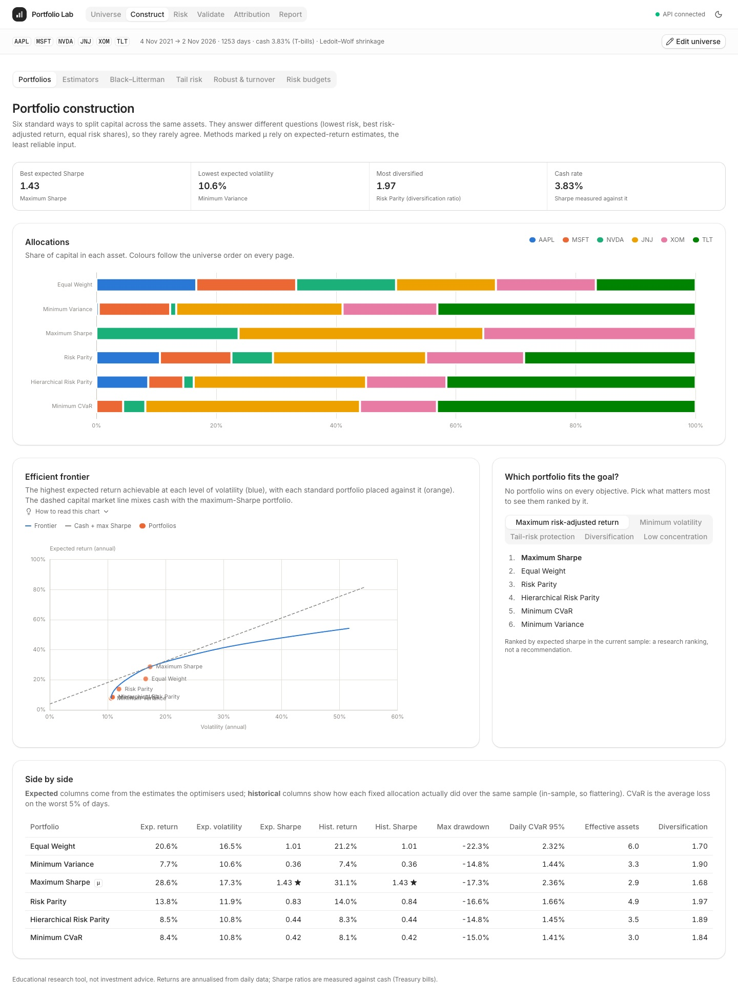
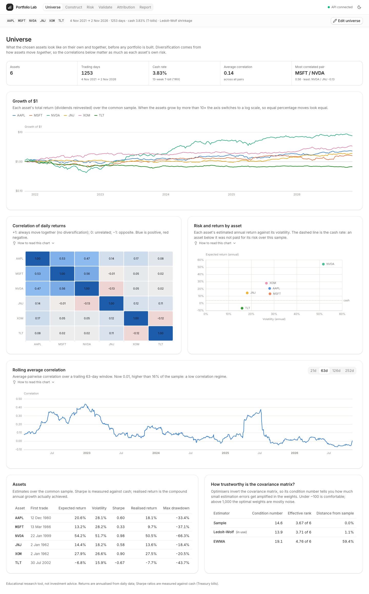
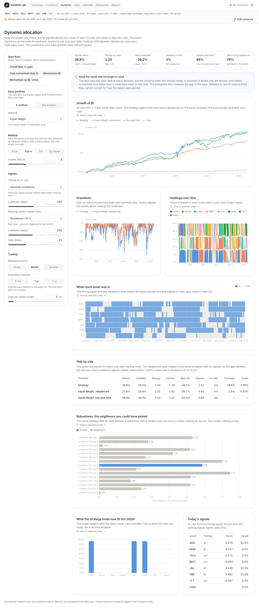
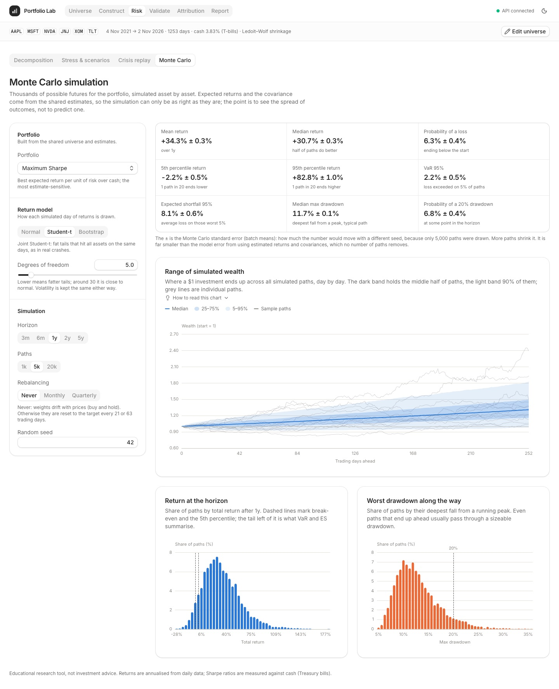
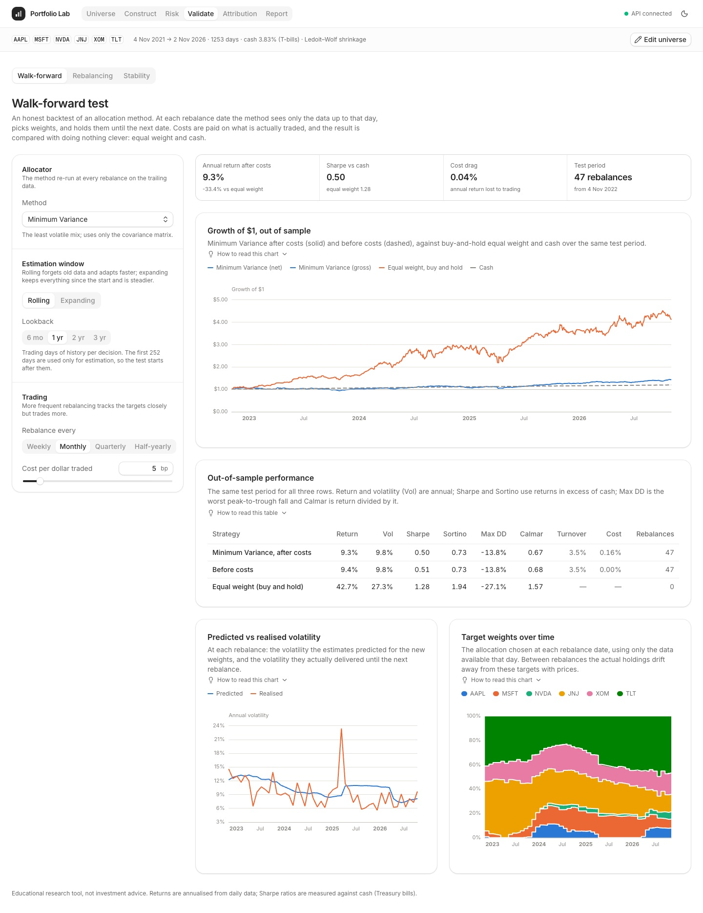

# Portfolio Construction & Risk Lab

An interactive lab for **building, stress-testing and validating multi-asset portfolios**. Pick
any set of tickers. The lab compares how standard methods split capital across them, shows
where each portfolio's risk comes from, and tests how it behaves in crises and simulations.
It also measures how much of an "optimal" allocation survives out-of-sample data, trading
costs and resampling. Every number comes from a tested Python library (`portlab`), served by
a FastAPI backend and explored through a React web app.


[](LICENSE)

> **Educational research tool.** Nothing here is investment advice. Expected returns and
> covariances are estimates from history; backtests and simulations are conditional on them.

The project is built around one question:

> **How should capital be split across assets, where does the resulting risk come from, and
> how much confidence does an allocation built from noisy historical estimates deserve?**

---

## Contents

- [Application overview](#application-overview)
- Areas: [Universe](#universe) · [Construct](#construct) · [Dynamic](#dynamic) · [Risk](#risk) ·
  [Validate](#validate) · [Attribution](#attribution) · [Report](#report)
- [Correctness](#correctness)
- [Architecture](#architecture)
- [Technology](#technology)
- [Getting started](#getting-started)
- [Deployment](#deployment)
- [Methodological notes](#methodological-notes)

---

## Application overview

<p align="center">
  
</p>

Every page works on one shared **research universe**, edited from the bar under the header:
- the tickers;
- the start date;
- the expected-return and covariance estimators;
- an optional cap on single-asset weights;
- the cash rate, which is the 13-week Treasury bill yield unless set by hand.

The universe also carries **portfolio constraints**, which every optimising method enforces
exactly:
- long-short with a cap per short position and on gross exposure (e.g. 130/30);
- a cap per sector or asset class (Yahoo's sector for stocks, fund category for ETFs);
- a maximum number of holdings;
- a tracking-error limit against equal weight.

The cluster-based methods are long-only by construction, and the tables flag them when
constraints are active.

The sample starts on the first day *all* chosen assets traded. When a young asset (TSLA,
listed in 2010) shortens the requested history, the bar says so.

Inputs are debounced and results update in place. Every chart has a "How to read this chart"
explanation.

## Universe

<p align="center">
  
</p>

- Growth of $1 for each asset.
- Correlation heatmap, and estimated risk against return relative to cash.
- Rolling average correlation with regime labels (correlations jump in sell-offs).
- Per-asset statistics, and covariance-matrix diagnostics: condition number and effective rank
  for the sample, Ledoit–Wolf and EWMA estimators.

## Construct

- **Portfolios:** eleven allocators side by side:
  - classical: equal weight, minimum variance, maximum Sharpe;
  - risk-based: risk parity, maximum diversification, minimum CVaR;
  - growth and robustness: growth-optimal (Kelly), resampled max Sharpe (Michaud);
  - cluster-based: HRP, HERC, NCO.

  The page shows their allocations, expected and historical statistics, the efficient frontier
  with the capital market line, and a ranking for each objective.
- **Estimators:** one allocator under all nine combinations of the return and covariance
  estimators. The weights move more with the estimates than with the method.
- **Black–Litterman:** a market-value prior (market capitalisation, or fund size for ETFs)
  tilted toward your views in proportion to your confidence.
- **Tail risk:** minimum CVaR (expected shortfall) against variance-based portfolios.
- **Robust & turnover:** a penalty for uncertain means, and turnover-aware rebalancing from
  the current portfolio.
- **Risk budgets:** choose each asset's share of risk instead of capital.

## Dynamic

<p align="center">
  
</p>

Keep the assets you chose, but let signals decide how much of each to hold, and when to step
into cash.

- **Signals,** computed per asset using only past closes:
  - timing filters from project 02: trend, SMA and EMA crossovers, MACD, Donchian breakout,
    absolute momentum vs T-bills, and a trend + volatility regime;
  - cross-sectional ranks: 12-1 momentum, volatility-adjusted momentum, short-term reversal,
    low volatility.
- **Signals → weights,** around a base portfolio (your own weights or any allocator):
  - **filter:** out-of-signal assets go to cash or to the rest;
  - **top-k rotation:** with a timing filter, empty slots are held in cash, as in dual momentum;
  - **tilt:** weights lean toward high scores;
  - **Black–Litterman views:** scores become return views, weighed against risk by max Sharpe.
- **Honest evaluation:**
  - The strategy runs on the shared engine (costs, drift, cash).
  - It is compared with the same base **rebalanced on the same schedule without signals**, so
    the gap is the signals' contribution, plus buy-and-hold and cash.
  - The probability of beating the base is deflated for the neighbouring configurations tried,
    and a robustness grid shows those neighbours.
  - The page ends with today's signals and target weights.

## Risk

- **Decomposition:** capital weight against risk contribution, diversification ratio and
  effective number of assets. Includes a volatility-targeting overlay that holds cash.
- **Stress & scenarios:** correlations pushed toward +1 and volatilities scaled up, plus custom
  return shocks per asset.
- **Crisis replay:** seven historical crises with today's weights, from the dot-com bust to
  the 2025 tariff shock.
  - Each replay uses every asset's full history, whatever the research window.
  - Assets that had not listed yet are reported and their weight redistributed.
  - Recovery time is measured past the end of the crisis window, until the holdings regained
    their pre-crisis peak.
- **Monte Carlo:** asset-level simulation under three models:
  - correlated normal returns;
  - a joint Student-t, where fat tails hit all assets on the same day;
  - a block bootstrap of history.

  Weights can drift or be rebalanced. Results are a fan chart, terminal-return and drawdown
  distributions, and VaR/ES, each with its Monte Carlo standard error.

<p align="center">
  
</p>

## Validate

<p align="center">
  
</p>

- **Walk-forward:** re-estimate and re-allocate on a schedule using only past data.
  - Holdings drift between rebalances and costs are paid on what is actually traded.
  - Results after costs are compared with buy-and-hold equal weight and with cash, and
    predicted volatility with realised volatility.
- **Rebalancing:** never, by the calendar, or when an asset or the whole portfolio drifts too
  far. The page weighs cost against tracking error.
- **Stability:** resample history (IID or block bootstrap), re-optimise, and see the
  distribution of each weight.

## Attribution

- Alpha, beta, tracking error, information ratio and up/down capture against any benchmark
  ticker.
- Contributions per asset, and exposures to ETF-based style-factor proxies.

## Report

A Markdown research summary for any portfolio, downloadable. It runs its own bootstrap,
walk-forward, stress, crisis and benchmark analyses, so the same universe always produces the
same report.

---

## Correctness

The library is tested offline against a bundled price snapshot. Each fix below has a test that
pins it to a concrete number:

- **Cash is not free.** Sharpe and Sortino ratios use returns in excess of the T-bill rate,
  and maximum Sharpe uses it too. Over a 2021–2026 sample (3.8% average T-bill yield), ignoring
  cash overstated the equal-weight Sharpe ratio by 0.23.
- **One backtest engine** for every lab:
  - weights drift between trades;
  - a decision at day *t*'s close earns from *t + 1*;
  - costs are charged per dollar traded;
  - uninvested weight earns cash.

  Walk-forward turnover is measured against drifted weights, not the previous target.
- **No silent truncation.** The universe reports each ticker's first trade and which ones moved
  the sample start.
- **Jensen's alpha** against a benchmark is measured on returns in excess of cash, so a cash
  sleeve is never mistaken for skill.
- **Robust mean-variance** penalises the standard error of the *annualised* mean,
  √(252·σ²/T), checked against simulation.
- **Exact convex optimisation** (cvxpy) replaces SLSQP started from equal weights, which
  stopped short of the optimum.
  - Max Sharpe and maximum diversification use the Cornuéjols–Tütüncü change of variables, so
    linear constraints carry over exactly.
  - Unconstrained solutions match the closed forms Σ⁻¹1/1ᵀΣ⁻¹1 and Σ⁻¹(μ − r_f).
  - Under caps, no random feasible portfolio beats them.
  - Risk parity solves Spinu's convex problem.
  - NCO reproduces global minimum variance exactly when clusters are independent.
- **No look-ahead in signals:** every signal is tested to give identical values on data truncated
  at any day. An always-on filter reproduces the rebalanced base exactly, and an all-off filter
  earns exactly cash.
- **Ledoit–Wolf shrinkage** is implemented directly and matches scikit-learn to 1e-19.
- **Monte Carlo errors** are reported for every simulated statistic (batch means), and the
  simulated mean matches the model's analytic mean within that error.

## Architecture

```text
frontend/  React + TypeScript ── fetch /api/* ──▶  backend/src/portlab_api/  FastAPI
                                                      │  JSON ⇄ library objects
                                                      ▼
                                                 backend/src/portlab/  portfolio library
                                                      (NumPy, pandas, SciPy)
```

- `portlab.data`:
  - prices fetched once per ticker for the full history, with a memory and disk cache;
  - a stale fallback, then a bundled snapshot, when Yahoo Finance is unavailable;
  - the aligned `Universe`;
  - market values.
- `portlab.optimization.registry`: every allocator behind one signature,
  `(Estimates, Constraints) → weights`.
- `portlab.optimization.convex`: one `Constraints` set translated into cvxpy constraints in one
  place, so every method means the same thing by "130/30" or "≤40% per sector".
- `portlab.backtest`: the shared daily simulator used by walk-forward and rebalancing.
- Frontend TypeScript types are generated from the API's OpenAPI schema (`make api-types`), so
  the two halves cannot drift apart.

## Technology

| Area | Choice |
|---|---|
| Library | Python 3.13, NumPy, pandas, SciPy, cvxpy (Clarabel) |
| Market data | yfinance (cached per ticker, bundled snapshot fallback) |
| API | FastAPI + Pydantic v2 |
| Frontend | Vite 8, React 19, TypeScript 6, Tailwind CSS 4, coss UI (Base UI), ECharts 6, TanStack Query |
| Quality | pytest, ruff, pyright; tsc, oxlint, prettier; Playwright smoke test |

## Getting started

```bash
make install   # backend venv with the library, API and dev tools; npm install
make dev       # API on :8030 and Vite on :5183 → open http://localhost:5183
make test      # offline test suite
make e2e       # browser smoke test over every page (needs `make dev` + Google Chrome)
make lint      # ruff, pyright, tsc, oxlint, prettier
```

API documentation is at http://localhost:8030/docs while the API runs.

## Deployment

- **Docker / Render:** the `Dockerfile` builds the web app and serves it from the API on `$PORT`;
  `render.yaml` is a ready Render Blueprint.
- **Vercel:** `vercel.json` defines two services: the Vite site, and the FastAPI app as a Python
  function under `/api`.

## Methodological notes

- Expected returns are historical estimates and the least reliable input. Methods marked μ in
  the app depend on them.
- Results computed over the same sample used for estimation are in-sample and flattering. The
  walk-forward page is the out-of-sample check.
- Crisis replays apply today's static weights to past returns. They are diagnostics, not
  forecasts.
- The attribution factors are transparent ETF proxies (e.g. IWD − IWF for value), not the
  official Fama–French factors.

## License

MIT, see [LICENSE](LICENSE).
